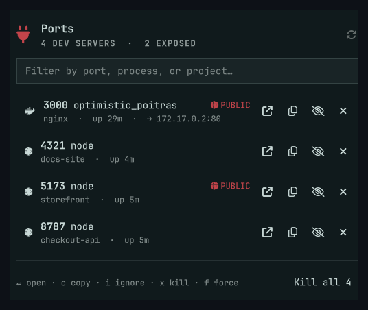
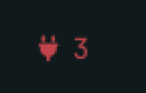
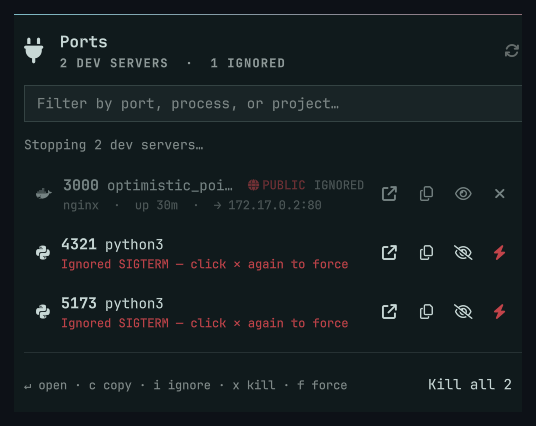

# NetBar

A status bar widget for Omarchy that lists the ports currently listening on
your machine and lets you kill whatever is holding them.

The problem it solves is narrow. You start a dev server, get pulled onto
something else, and two days later port 3000 is still bound and you have no
idea which checkout did it. NetBar keeps that count in the bar and gives you a
one click way to shut things down.



The bar itself shows the count. It switches to your theme's urgent color when
one of those ports is reachable from outside the machine.



## Contents of a row

| Field | Notes |
|---|---|
| Port and process | `3000  node · vite`. The toolchain is only shown when it differs from the process name. |
| Project | Found by walking up from the process working directory to the nearest `.git`, `package.json`, `Cargo.toml`, `go.mod`, `pyproject.toml`, `Gemfile` or `composer.json`. |
| Uptime | Six hour old listeners are usually forgotten ones. |
| Connections | Established connections to that port, which separates "in use" from "abandoned". |
| Exposure | `PUBLIC` for a wildcard bind, `LAN` for a specific interface, nothing at all for loopback. |

The count in the bar is not the number of open ports. It counts *strays*:
listeners that look like dev servers and that you have not marked as expected.
On a quiet machine it should read zero.

## Actions

| Action | Mouse | Key |
|---|---|---|
| Open `http://localhost:<port>` | Click the row, or the ↗ button | `enter`, `o` |
| Copy that URL | ⧉ button, or middle click | `c` |
| Ignore or un-ignore the port | 👁 button | `i` |
| Stop the process (SIGTERM) | ✕ button | `x`, `delete` |
| Force stop (SIGKILL) | ⚡ button, after SIGTERM is ignored | `f`, confirmed |
| Stop every stray | "Kill all N" | `a` |
| Filter the list | Search field | `/` |
| Rescan | ↻ in the header, or right click the bar icon | `r` |
| Include system and other-user ports | | `s` |

### Escalation

The ✕ button sends SIGTERM. If the process is still listening a few seconds
later, the button turns into a ⚡ and sends SIGKILL instead. Force is only
offered once the polite signal has visibly failed, which keeps it out of reach
of a stray click. The `f` key forces the selected row at any time but always
asks for confirmation, since in that case there is no earlier SIGTERM to
justify it.



Containers are excluded. They are stopped through `docker stop`, so SIGKILL is
not the right escalation for them.

Rows that NetBar cannot act on, such as a port held by root or another user,
show the owning account and the well known service name for that port. Their
kill button is disabled rather than offered and then failing.

## Docker

NetBar only sees containers that publish a host port, meaning `docker run -p`.
A container started without `-p` holds no socket on the host, so there is
nothing for a port scanner to find. `docker ps` lists those with a bare
`80/tcp`, which means exposed but not published.

Finding a published container port needs no privileges. `docker-proxy` runs as
root, so `ss` will not name its socket for an unprivileged caller and the port
would otherwise appear as an anonymous root listener. Its command line is
world readable though, and it spells out the whole mapping:

```
/usr/bin/docker-proxy -proto tcp -host-ip 0.0.0.0 -host-port 3000 \
                      -container-ip 172.17.0.2 -container-port 80
```

NetBar reads those out of `/proc` and joins them onto the listening sockets by
port number. Container ports are therefore always counted, and always show
where they land, with no access to the Docker daemon at all.

Naming the container, and stopping it, does need the daemon. If you are not in
the `docker` group the panel offers a one click **Enable**. That authenticates
through the Omarchy polkit dialog and installs two files:

| Path | Purpose |
|---|---|
| `/usr/local/lib/netbar/netbar-docker` | Root owned helper. Accepts two verbs, `ps` and `stop <id>`, and validates the id. |
| `/etc/sudoers.d/netbar-docker` | `NOPASSWD` for that single absolute path. No wildcards. |

This is intentionally not `usermod -aG docker`. Membership of the `docker`
group is equivalent to passwordless root, since `docker run -v /:/host` hands
over the filesystem. The grant here covers two fixed operations. The sudoers
rule is checked with `visudo -c` before installation, so a malformed drop-in
cannot lock you out of `sudo`.

To undo it:

```bash
pkexec ./netbar-enable-docker.sh --disable
```

Set `dockerPrompt` to `false` if you would rather not be offered this at all.

## Ignoring ports

Postgres on 5432 and Redis on 6379 are not strays, they are your setup. Press
`i` to drop a port out of the badge count and grey it out in the list. Rules
are keyed by port rather than PID, so they survive a service restart. They
live in:

```
~/.local/state/omarchy/netbar/ignored.json
```

## Security

Scanning and killing never involve root. NetBar signals only processes the
kernel already permits you to signal. `ss` attributes a socket to a PID only
when the socket belongs to you; for everything else NetBar reads the owning
uid out of `/proc/net/tcp`, which is enough to print "root" or
"systemd-resolve" instead of "unknown", and disables the kill button.

Anything that is not clearly your own dev server takes two presses to kill. A
system daemon or another user's process says so on the row before it acts.

PIDs get recycled. Between the scan that drew a row and the click that kills
it, the number can belong to something else, so the helper re-reads
`/proc/<pid>/comm` and refuses if it no longer matches what was listed.

The only privileged path is the optional Docker grant described above. The
helper it installs pins its own `PATH` and uses an absolute interpreter, so
neither the shell nor the `docker` binary can be resolved through a `PATH` an
attacker controls. Nothing else in NetBar depends on it.

Browsers, editors and chat clients are kept out of the stray count even though
they are yours and listening. Killing Firefox from a port widget would be a
surprising way to lose your tabs. Press `s` to see them anyway.

## Settings

There is no settings GUI. Setup > Plugins only enables, disables, adds, clones
and removes plugins. Use `omarchy bar set`:

```bash
omarchy bar set lugossi.netbar hideWhenIdle true
omarchy bar set lugossi.netbar refreshIntervalSec 30
omarchy bar set lugossi.netbar notifyOnNew true
```

Those land on the widget's entry in `~/.config/omarchy/shell.json`, which hot
reloads. Values are written as strings unless you pass `--json`; every setting
below accepts either form. To reset one, delete the key from that entry.

| Key | Default | Meaning |
|---|---|---|
| `refreshIntervalSec` | `15` | Rescan interval while the panel is closed. Open, it polls every 2s. |
| `includeUdp` | `false` | Include UDP sockets. Mostly mDNS and DNS noise, hence off. |
| `notifyOnNew` | `false` | Desktop notification the first time a dev server appears on a port. |
| `showSystem` | `false` | Include listeners you cannot kill. `s` toggles this for the session. |
| `hideWhenIdle` | `false` | Hide the widget completely when nothing is listening. |
| `dockerPrompt` | `true` | Offer the Docker grant when the daemon is running but unreadable. |

## Install

```bash
omarchy plugin add https://github.com/Lugossi/Netbar.git --enable --yes
omarchy bar move lugossi.netbar --section right
```

That clones into `~/.config/omarchy/plugins/lugossi.netbar`, named from the
manifest id. Plugins normally land disabled so you can read the code before
running it, since they execute unsandboxed inside `omarchy-shell`; drop
`--enable --yes` if you would rather review first and enable by hand.

Updating and removal go through the same command:

```bash
omarchy plugin update lugossi.netbar
omarchy plugin remove lugossi.netbar
```

Requires `python3` and `iproute2`, both of which ship with Omarchy. Docker is
optional.

For local work on the plugin itself, symlink a checkout instead of cloning:

```bash
ln -s /path/to/NetBar ~/.config/omarchy/plugins/lugossi.netbar
omarchy-shell shell rescanPlugins
omarchy plugin enable lugossi.netbar --section right
```

## IPC

```bash
omarchy-shell lugossi.netbar toggle
omarchy-shell lugossi.netbar refresh
omarchy-shell lugossi.netbar count
omarchy-shell lugossi.netbar killAll
```

`count` returns the stray count on stdout, which is useful in a Hyprland
keybind or a shell prompt when you want the number without opening anything.

## Implementation

`netbar-scan.py` calls `ss` for listening sockets and established connection
counts, enriches each PID from `/proc` (command line, working directory, uid,
start time), classifies the toolchain, and prints one JSON document.
`Service.qml` owns the scan interval, the ignore list and every process that
gets spawned. `NetBar.qml` is presentation only.

A bar surface exists per monitor, so the widget is constructed once per screen.
One instance is elected through `bar.moduleWidgets()` and is the only one that
scans or sends notifications; it pushes results to the others so their badges
still render. Without that, a two monitor desk gets every notification twice.

The scanner is a normal command line tool and works on its own:

```bash
./netbar-scan.py scan | jq '.ports[] | select(.isDev)'
```

## Development

The plugin is installed as a symlink, and `inotifywait -r` does not follow
symlinks, so edits do not hot reload. QML is compile cached as well, which
means `rescanPlugins` alone will not pick up `.qml` changes.

```bash
./dev-reload.sh
```

That lints, then restarts the shell. It intentionally does not call
`rescanPlugins` first: hot reloading changed plugin code into a live shell
produced repeated quickshell SIGSEGVs during development, with the crash
handler firing inside `QQmlComponent::createObject`. A plain restart has never
done that.

To lint by hand you need an import shim so `qs.Ui` and `qs.Commons` resolve:

```bash
mkdir -p /tmp/nb/qs
ln -sfn /usr/share/omarchy/shell/Ui /tmp/nb/qs/Ui
ln -sfn /usr/share/omarchy/shell/Commons /tmp/nb/qs/Commons
/usr/lib/qt6/bin/qmllint -I /tmp/nb -I /usr/lib/qt6/qml NetBar.qml Service.qml
```

Use the Qt6 binary. `/usr/bin/qmllint` is the Qt5 one and reports nothing.
`Member "..." not found on type "QObject"` warnings are expected, since
`Style.font`, `Style.spacing` and the injected `bar` are dynamic objects that
qmllint cannot resolve statically. Treat `[syntax]` and `[unqualified]` as
real.

## Limitations

Containers with no published port are invisible, since they hold no host
socket. The same applies to setups running with `userland-proxy=false`, where
Docker forwards in iptables and there is no `docker-proxy` to read.

Podman is not handled.

Root owned listeners are identified by port and owner, never by process name.
Mapping a socket inode to a PID requires reading other users' `/proc/*/fd`,
which needs root.

## License

MIT
